# N5Deal Marketplace Prototype

## Prototype Overview

N5Deal is a marketplace prototype connecting buyers and sellers of financial licenses and payment infrastructure. The application supports three distinct user roles with role-based dashboards and permissions:

- **Buyers** can browse assets, save interests, and contact sellers
- **Sellers** can publish and manage asset listings, view buyer profiles, and communicate with interested parties
- **Platform Managers** can oversee the marketplace, manage user status, and remove non-compliant listings

Built with **Next.js 16**, **TypeScript**, **Prisma ORM**, and **SQLite**, the prototype showcases modern full-stack development practices including real-time data persistence, form validation, and role-based access control.

---

## Data Models

### Core Entities

```
User (Central Auth)
├── role: "BUYER" | "SELLER" | "MANAGER"
├── status: "ACTIVE" | "SUSPENDED"
├── email: unique identifier
└── Relationships: Buyer profile, Seller profile, Messages (sent/received)

Asset (Marketplace Listing)
├── descriptionShort: title and overview
├── country: target market
├── askingPrice & currency: valuation
├── typeOfBusiness: Bank, Fintech, Payment, EMI, Crypto
├── typeOfLicense: MSB, PI, EMI, etc.
├── businessStatus: Active / Not active
├── assetType: Active Business (Licensed) / License only
├── regulatory: compliance info
├── isValidated: manager review status
├── views & favorites: engagement metrics
└── Relationships: Seller, Company, Benefits (many-to-many), Messages

Seller
├── companies: Company profiles (payment infrastructure, FX services, etc.)
├── assets: Published listings
└── Relationships: User, Companies, Assets

Buyer
├── contactName: investment manager name
├── companyName: firm name
├── investmentInterests: acquisition criteria
└── Relationships: User

Company
├── name & overview: Company information
├── accountDetails: Banking/settlement specifics
├── assets: Related business listings
└── Relationships: Seller

Message (P2P Communication)
├── content: inquiry or response
├── assetId (optional): linked to specific asset
├── createdAt: timestamp
└── Relationships: Sender (User), Receiver (User), Asset

Benefit (Asset Tags)
├── name: Foreign-Exchange, Virtual-Currency, Money-Transfer, API Access, Payment Accounts
└── Relationships: Assets (many-to-many)
```

## Getting Started

### Prerequisites

- Node.js 18+
- npm or yarn

### Installation

```bash
# Clone the repository
git clone https://github.com/Tamskray/test_n5deal.git
cd test_n5deal

# Install dependencies
npm install

# Set up environment
cp .env.example .env
# Update DATABASE_URL if needed (default: file:./dev.db)

# Generate Prisma client
npx prisma generate

# Seed demo data
npx prisma db seed

# Start development server
npm run dev
```

The application will be available at `http://localhost:3000`

---

## Screenshots

### Demo Login

All three user roles can be accessed via quick-click demo login:
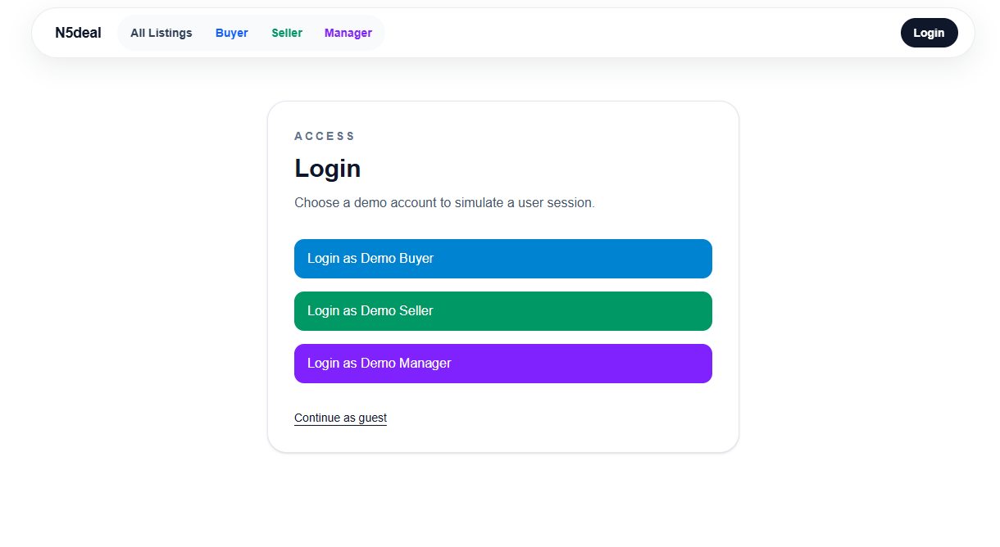

### All Listings - Public Marketplace

Browse, search, and filter available assets:
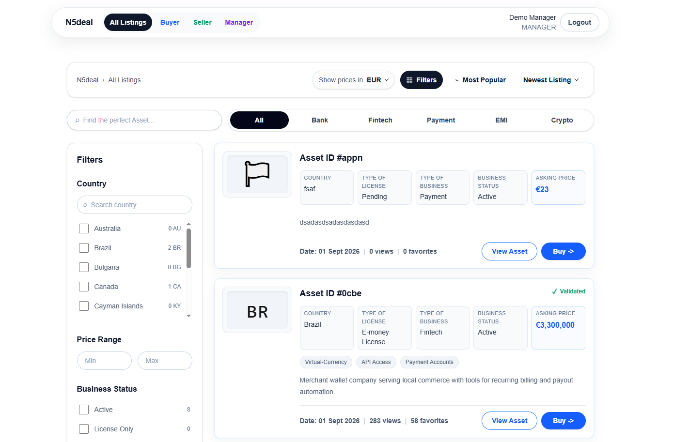

### Listings with Advanced Filters

Filter by country, business status, and price range:
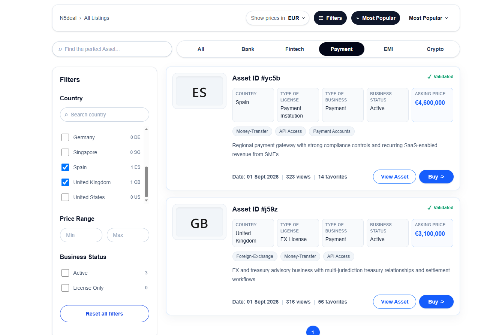

### Asset Detail Page

View full asset information with seller contact and messaging options:
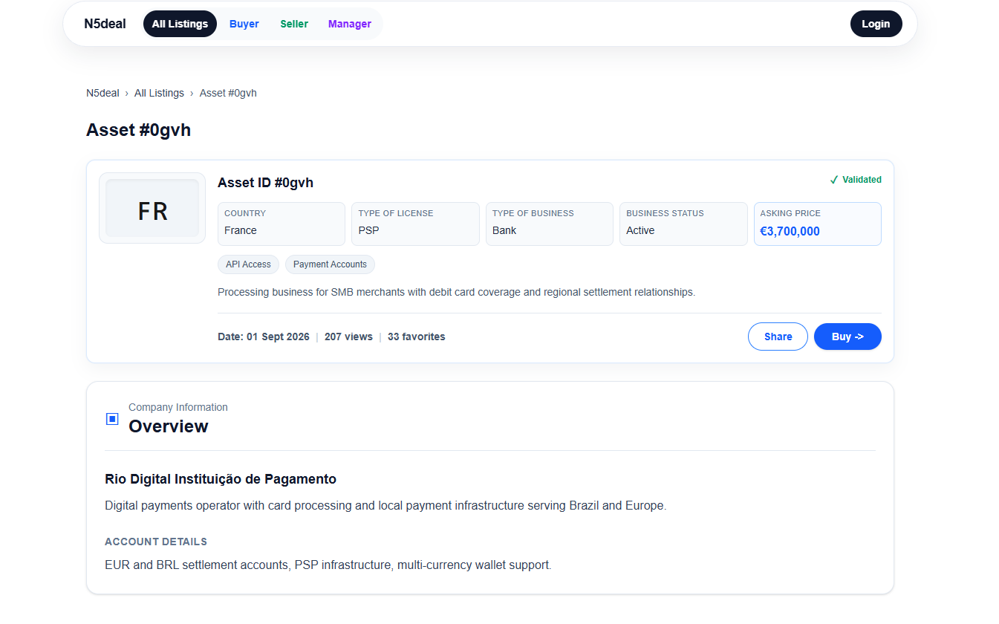

### Asset Inquiry Form

Send messages to sellers with asset context:
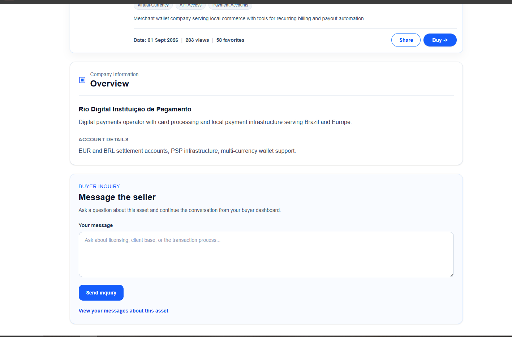

### Seller Dashboard

Manage published assets with edit/delete actions and publish new listings:
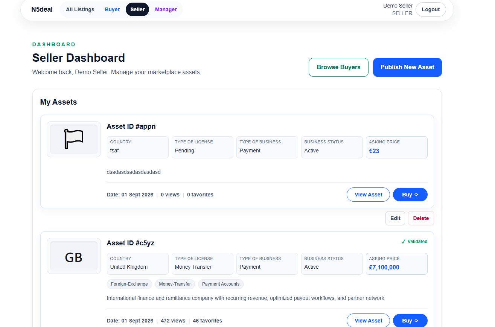

### Asset Publishing Form with Validation

Create new assets with form validation and error feedback:
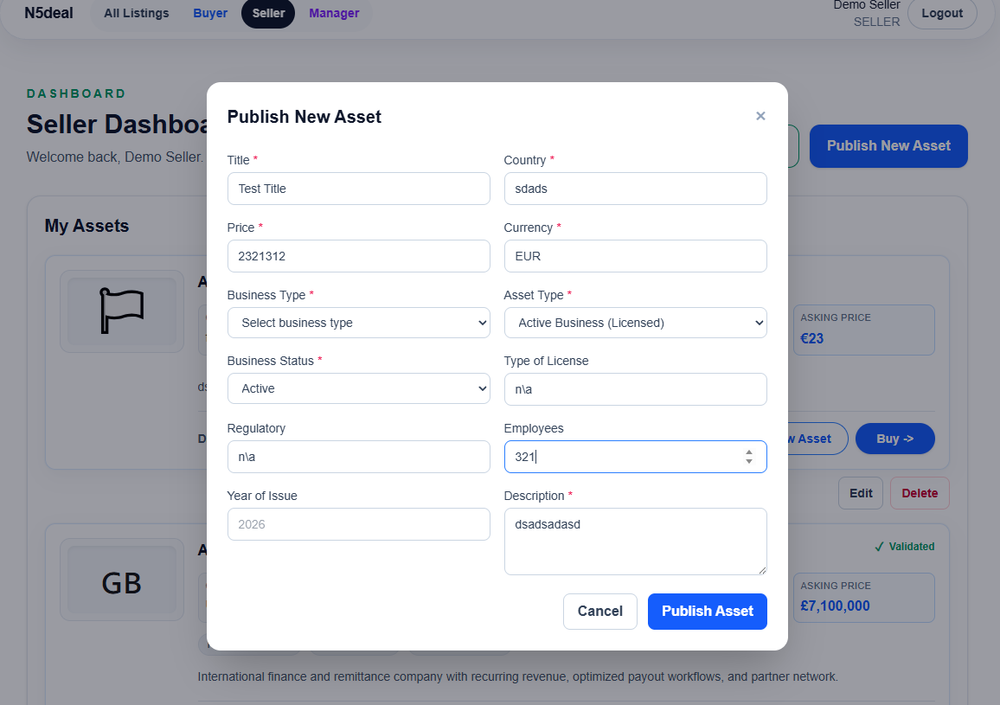

### Form Validation in Action

Visual feedback for form errors:
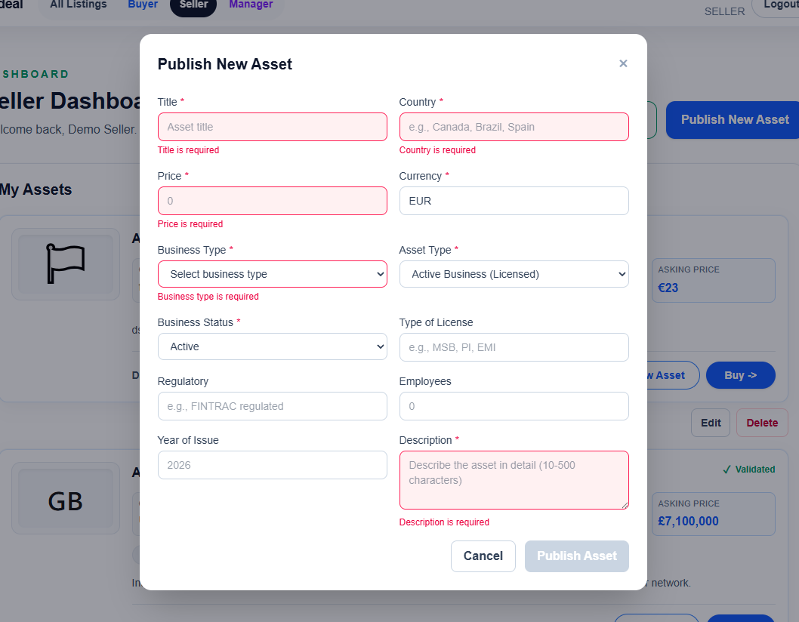

### Seller Browse Buyers

Discover buyer profiles and investment interests, send direct messages:
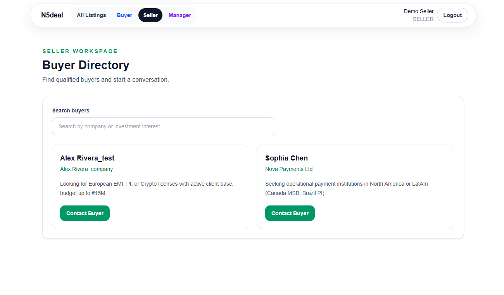

### Seller Messages to Buyers

Track communications with potential investors:
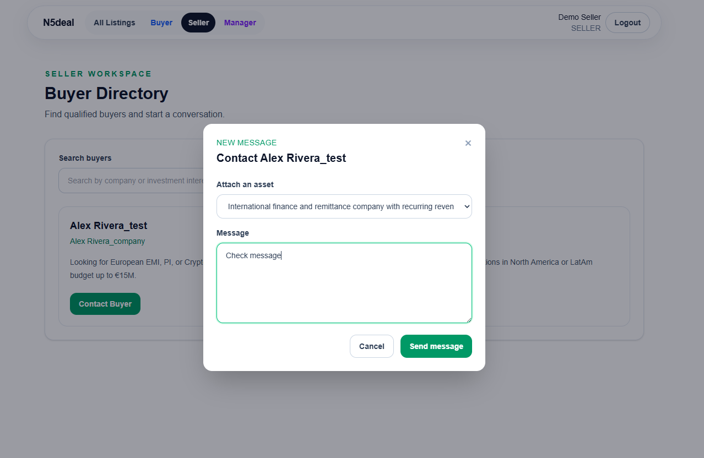

### Buyer Dashboard

Manage investment profile and track inquiries/messages from sellers:
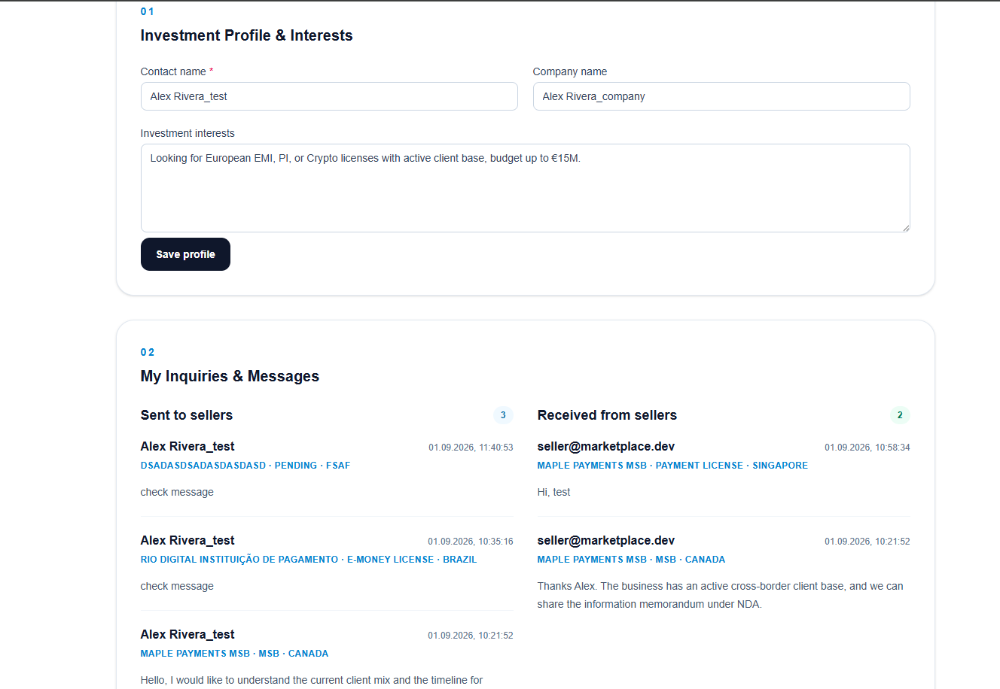

### Platform Manager Dashboard

Manage users and remove listings:
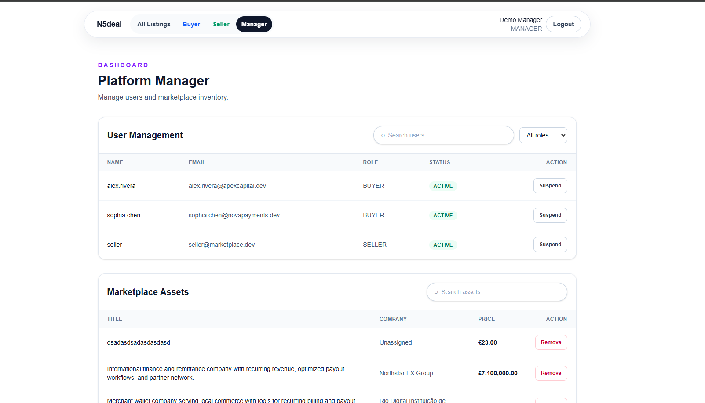
